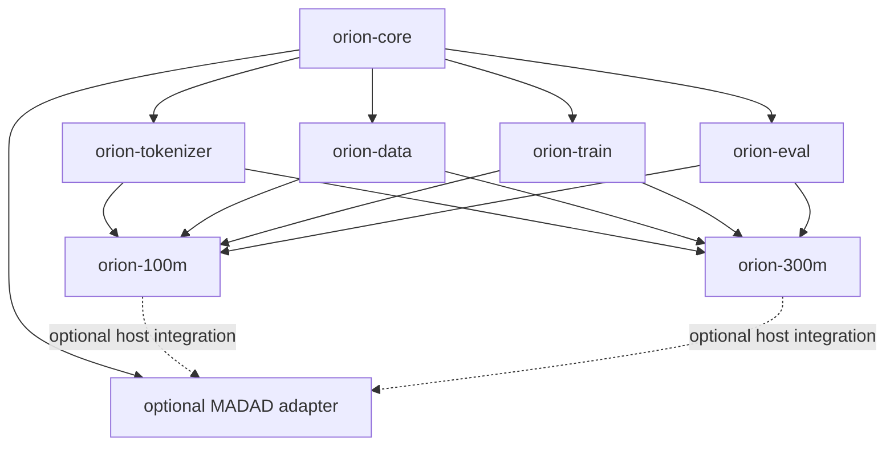

# Architecture audit

## Package and runtime structure

`orion-core` owns common config, schemas, safe serialization, hashing, device helpers and Transformer blocks. `orion-tokenizer` owns the shared byte-BPE interface and explicit local training. `orion-data`, `orion-train`, and `orion-eval` own preprocessing, optimization/recovery, and metrics/sealed evaluation. The two model packages own their distinct encoder/decoder implementations and SDKs. `orion-madad-adapter` is isolated. The package independence suite passed; MADAD itself was not modified.

## Mathematical/implementation evidence

The parameter-count tool instantiates the actual default architectures and reports **100,291,840** and **306,763,200 unique** parameters. Tests exercise encoder bidirectionality, local/global masks, RoPE, GQA, causal masking, tied embeddings, gradients, padding, and cache parity on synthetic tensors. Shared attention uses PyTorch SDPA with a GQA fallback. Decoder-only, prefix-LM and encoder-decoder pilot implementations exist; no empirical architecture winner is declared.

## Decisions and limitations

No architecture change is recommended based on this audit. The supplied 300M plan calls for DDP on up to eight GPUs and FSDP only if memory-bound; FSDP therefore remains conditional, not a mandatory feature for a recommended single 80-GB device. It is not implemented and would need an optimizer/checkpoint lifecycle refactor plus accelerator tests before use. E-300-1 real-data comparisons remain an external decision gate. The shared tokenizer’s special-token map is approved for experimental research; production data, model training and release gates remain open.

Evidence: [`decisions.md`](../../docs/architecture/decisions.md), [`orion-100m.md`](../../docs/architecture/orion-100m.md), [`orion-300m.md`](../../docs/architecture/orion-300m.md), `python tools/count_params.py`, and `tests/test_architectures.py`.
